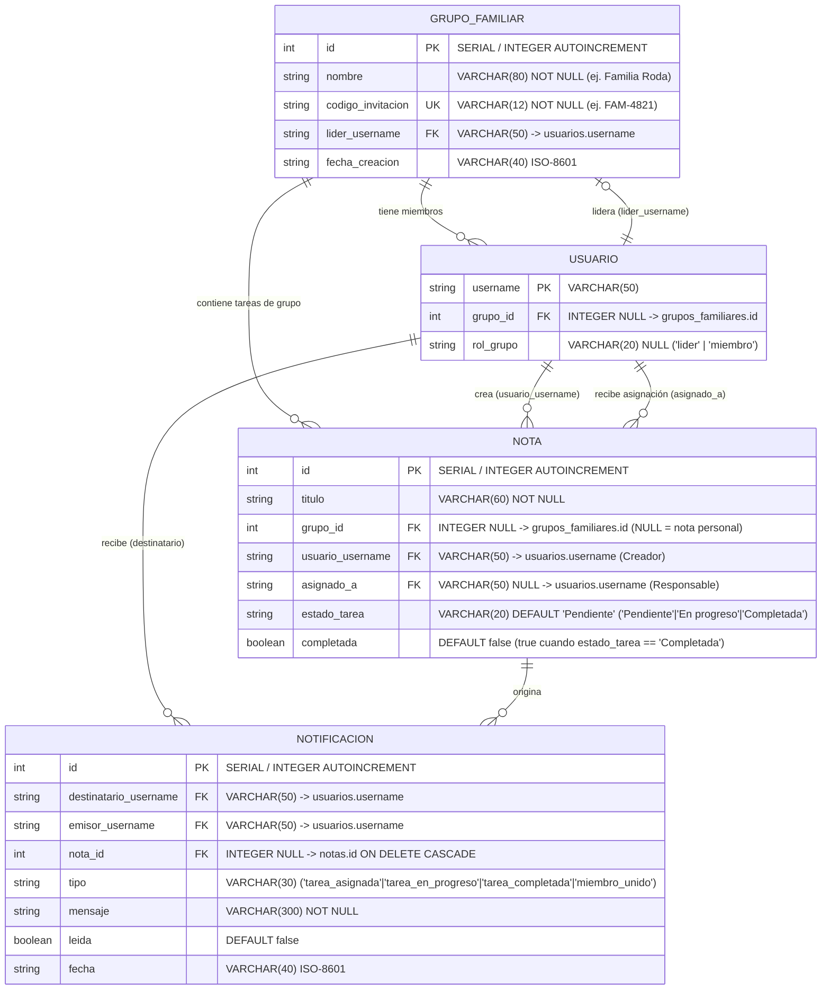
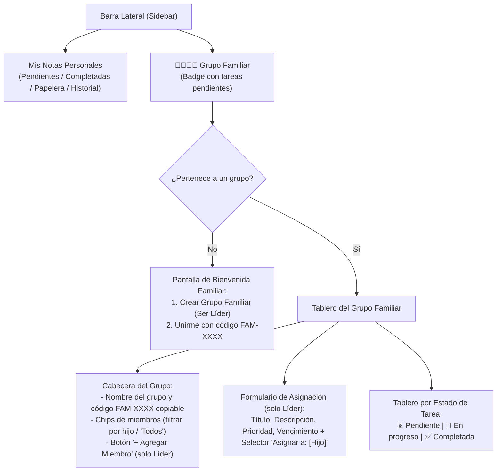

# Spec 02 — Grupos Familiares, Delegación de Tareas y Sistema de Notificaciones

- **Proyecto**: AppNotas (Esc. Superior N°49 "Cap. Gral. J.J. Urquiza" — Prácticas Profesionalizantes I)
- **Estado**: Propuesto para Revisión
- **Fecha**: 2026-11-10
- **Dependencias**: Requiere **Spec 01** (Modelo SQL en `models.py` con `Flask-SQLAlchemy`)

---

## 1. Objetivo y Caso de Uso Principal

Transformar **AppNotas** de una aplicación puramente individual a una plataforma colaborativa familiar.
- **Caso de uso ejemplar**: Una madre (o padre/tutor) crea un **Grupo Familiar** (ej. *"Familia Roda"*) convirtiéndose en su **Líder**. Sus hijos tienen sus propias cuentas en la aplicación y se vinculan al grupo (ya sea porque la madre los agrega por usuario/email o ingresando un código corto como `FAM-4821`).
- Dentro del espacio **Grupo Familiar**, el líder crea tarjetas y se las **asigna** a un miembro específico.
- Las tarjetas familiares atraviesan un flujo de **3 estados**: `Pendiente` → `En progreso` → `Completada`.
- El miembro asignado (hijo) puede avanzar el estado de la tarea, marcar subtareas y subir archivos adjuntos (fotos/PDFs como comprobante), pero **no puede eliminar la tarjeta ni modificar la consigna original** (título, descripción, prioridad o fecha límite) definida por el líder.
- Cada vez que el hijo cambia el estado (y especialmente cuando la marca como `Completada`), el **Líder del Grupo** recibe una **notificación en la campanita de la app** y un **correo electrónico automático** vía `Flask-Mail`.

---

## 2. Extensión del Modelo Entidad-Relación SQL

Sobre las tablas de la **Spec 01**, se incorporan las entidades `GrupoFamiliar` (`grupos_familiares`) y `Notificacion` (`notificaciones`), y se extienden `Usuario` y `Nota`:

### 2.1. Reglas de Integridad del Modelo
1. **Un grupo activo por usuario**: Cada registro en `usuarios` posee `grupo_id` (nullable) y `rol_grupo` (`"lider"` o `"miembro"`).
2. **Separación entre Notas Personales y Tareas Familiares**:
   - Si `nota.grupo_id IS NULL`: Es una nota personal privada del usuario (solo visible en sus bandejas personales o para un `docente`/`admin`).
   - Si `nota.grupo_id IS NOT NULL`: Es una tarjeta del Grupo Familiar, visible en la sección **Grupo Familiar** por los integrantes de ese grupo.
3. **Sincronización de Estado**:
   - `estado_tarea` admite `"Pendiente"`, `"En progreso"` y `"Completada"`.
   - Siempre que `estado_tarea == "Completada"`, el booleano `completada` se fija en `True`; en `"Pendiente"` o `"En progreso"`, `completada` es `False`.

---

## 3. Matriz de Permisos en el Grupo Familiar

| Acción sobre Grupo / Tarjeta Familiar | Líder del Grupo (Madre) | Miembro Asignado (Hijo) | Otro Miembro del Grupo |
| :--- | :---: | :---: | :---: |
| Ver miembros y código de invitación `FAM-XXXX` | ✅ | ✅ | ✅ |
| Agregar miembro por usuario/email o expulsar miembro | ✅ | ❌ | ❌ |
| Eliminar / disolver el grupo familiar | ✅ | ❌ (solo salir del grupo) | ❌ (solo salir del grupo) |
| Crear tarjeta familiar y asignarla a un miembro | ✅ | ❌ | ❌ |
| Editar título, descripción, prioridad, categoría, vencimiento o reasignar | ✅ | ❌ | ❌ |
| Cambiar `estado_tarea` (`Pendiente` → `En progreso` → `Completada`) | ✅ | ✅ | ❌ |
| Marcar/desmarcar subtareas de la tarjeta | ✅ | ✅ | ❌ |
| Subir archivos adjuntos (evidencia/fotos) a la tarjeta | ✅ | ✅ | ❌ |
| Enviar a Papelera / Eliminar tarjeta familiar | ✅ | ❌ | ❌ |

---

## 4. Diseño de Endpoints REST (`/api/v1`)

Se creará el módulo `resources/familia.py` y se extenderá `resources/grilla.py`:

### 4.1. Gestión del Grupo Familiar (`resources/familia.py`)
- **`GET /api/v1/familia`**
  - Devuelve la información del grupo actual del usuario autenticado (`id`, `nombre`, `codigo_invitacion`, `lider`, lista detallada de `miembros` con nombre, apellido, username, rol en el grupo y métricas de tareas pendientes/en progreso/completadas), o `{"grupo": null}` si no pertenece a ninguno.
- **`POST /api/v1/familia`**
  - Crea un nuevo grupo familiar (`{"nombre": "Familia Roda"}`). Genera un código único `FAM-XXXX`, asigna al usuario actual como `lider` y guarda el grupo.
- **`POST /api/v1/familia/unirse`**
  - Permite a un usuario sin grupo unirse ingresando `{"codigo": "FAM-4821"}`. Notifica al líder (`tipo: "miembro_unido"`).
- **`POST /api/v1/familia/miembros`** *(Solo Líder)*
  - Permite al líder agregar directamente a un usuario existente buscando por `username` o `email` (`{"identificador": "bruno"}`). Si el usuario existe y no tiene otro grupo, lo vincula inmediatamente y le envía una notificación en la app.
- **`DELETE /api/v1/familia/miembros/<string:username>`**
  - Si lo ejecuta el **Líder** sobre otro miembro: remueve a ese miembro del grupo.
  - Si un **Miembro** lo ejecuta sobre sí mismo: abandona el grupo.
- **`DELETE /api/v1/familia`** *(Solo Líder)*
  - Disuelve el grupo familiar, desvinculando a sus miembros.

### 4.2. Tarjetas del Grupo y Cambio de Estado (`resources/grilla.py`)
- **`GET /api/v1/grilla?contexto=familia`** (o `/grilla/completadas?contexto=familia`):
  - Devuelve todas las tarjetas activas del `grupo_id` del usuario autenticado (con filtro opcional `?asignado_a=<username>`).
- **`POST /api/v1/grilla`**:
  - Si incluye `grupo_id` (o `es_familiar: true`), valida que el usuario sea el **Líder** del grupo, asigna la tarjeta al miembro indicado en `asignado_a` con `estado_tarea = "Pendiente"` y crea una notificación para el hijo (`"Te asignaron una nueva tarea: <título>"`).
- **`PUT /api/v1/grilla/<int:id_nota>/estado`**:
  - Endpoint dedicado para cambiar el estado de una tarjeta (`{"estado_tarea": "En progreso"}` o `{"estado_tarea": "Completada"}` o `{"estado_tarea": "Pendiente"}`).
  - Permitido tanto al **Líder** como al **Miembro asignado** (`asignado_a`).
  - Cuando el miembro asignado cambia el estado:
    1. Si pasa a `"En progreso"`: Crea notificación in-app para el líder (`"🔔 <Nombre Hijo> comenzó la tarea '<Título>'"`).
    2. Si pasa a `"Completada"`: Crea notificación in-app para el líder (`"✅ <Nombre Hijo> completó la tarea '<Título>'"`) **y envía un correo electrónico** al email del líder mediante `Flask-Mail` (con manejo `try/except` no bloqueante por si el entorno local no tiene SMTP activo).

### 4.3. Centro de Notificaciones (`resources/familia.py`)
- **`GET /api/v1/notificaciones`**:
  - Lista las últimas 30 notificaciones del usuario autenticado ordenadas por fecha descendente + contador `no_leidas`.
- **`PUT /api/v1/notificaciones/leer`**:
  - Marca como leídas todas las notificaciones del usuario (o una específica si se envía `{"id": 12}`).

---

## 5. Diseño de Interfaz de Usuario (Frontend SPA en `static/`)

### 5.1. Nuevos Elementos Visuales
1. **Ícono de Campanita de Notificaciones en la Topbar**:
   - Ubicado en la barra superior junto al selector de vista y tema.
   - Muestra un badge rojo con el número de notificaciones no leídas (`no_leidas > 0`).
   - Al hacer clic, despliega un popover con el historial de avisos (ej. *"✅ Bruno completó la tarea 'Ordenar la pieza' — hace 5 min"*); al hacer clic en una notificación, abre directamente el panel de detalle de esa tarjeta.
2. **Sección «Grupo Familiar» en el Sidebar**:
   - **Estado sin grupo**: Muestra dos tarjetas limpias: *"Crear mi Grupo Familiar"* (para madres/padres líderes) y *"Tengo un código de invitación"* (para hijos/miembros).
   - **Estado con grupo**:
     - Cabecera con el nombre del grupo, el rol del usuario (`👑 Líder` o `👤 Miembro`), el código de invitación `FAM-XXXX` con botón de copiar en 1 clic, y los avatares/chips de los integrantes para filtrar tareas por hijo.
     - Si el usuario es **Líder**, ve el botón **«+ Agregar integrante»** (por nombre de usuario/email) y el formulario rápido para crear y asignar tareas eligiendo el miembro destinatario.
     - Si el usuario es **Miembro (Hijo)**, ve un filtro rápido *"Asignadas a mí"* vs *"Todo el grupo"*, y en cada tarjeta asignada a él tiene un selector directo de estado (`⏳ Pendiente` | `🔄 En progreso` | `✅ Completada`).
3. **Panel Lateral de Detalle adaptado según Permisos**:
   - Cuando un **Hijo** abre una tarjeta asignada a él, el título, la descripción, la prioridad y el botón de eliminar se muestran en modo **solo lectura**, mientras que el selector de **Estado (`Pendiente` / `En progreso` / `Completada`)**, el checklist de **Subtareas** y la subida de **Archivos Adjuntos** están completamente habilitados.

---

## 6. Datos Semilla de Demostración (Seed)

Para facilitar la prueba inmediata y la defensa académica del proyecto, el seeder de base de datos incluirá un grupo de ejemplo preconfigurado (o un usuario madre de prueba):
- Grupo **"Familia Scocco"** (`codigo_invitacion: "FAM-2026"`):
  - **Líder**: `nacho` (Rol en el grupo: `lider`)
  - **Miembros**: `alicia` y `bruno` (Rol en el grupo: `miembro`)
  - 3 tarjetas familiares de ejemplo asignadas a `alicia` y `bruno` en distintos estados (`Pendiente`, `En progreso`, `Completada`) y notificaciones de ejemplo en la campanita de `nacho`.

---

## 7. Criterios de Aceptación y Pruebas (Fase 2)

1. **Creación y Vinculación**: Un usuario puede crear un grupo familiar y otro usuario puede unirse mediante el código `FAM-XXXX` o ser agregado directamente por el líder mediante su username/email.
2. **Asignación y Restricción de Permisos**: Un miembro (`miembro`) recibe error `403 Forbidden` si intenta borrar una tarjeta familiar o cambiar su título, pero recibe `200 OK` al cambiar `estado_tarea` a `"En progreso"` o `"Completada"`, marcar subtareas o subir un adjunto.
3. **Notificación al Líder**: Al pasar una tarjeta a `"Completada"` desde la cuenta del hijo, se registra una notificación en la tabla `notificaciones` para el líder, el contador de la campanita del líder se incrementa y se intenta el envío de email vía `Flask-Mail`.
4. **Aislamiento de Datos**: Las tarjetas familiares no se mezclan desordenadamente con las notas privadas de otros usuarios ajenos al grupo.
